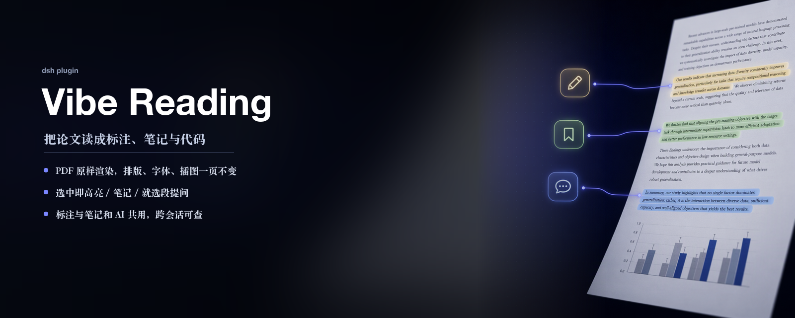
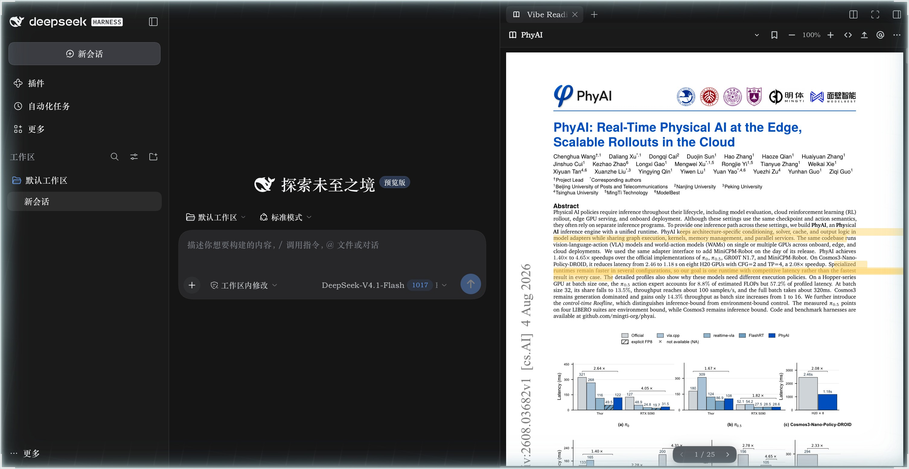
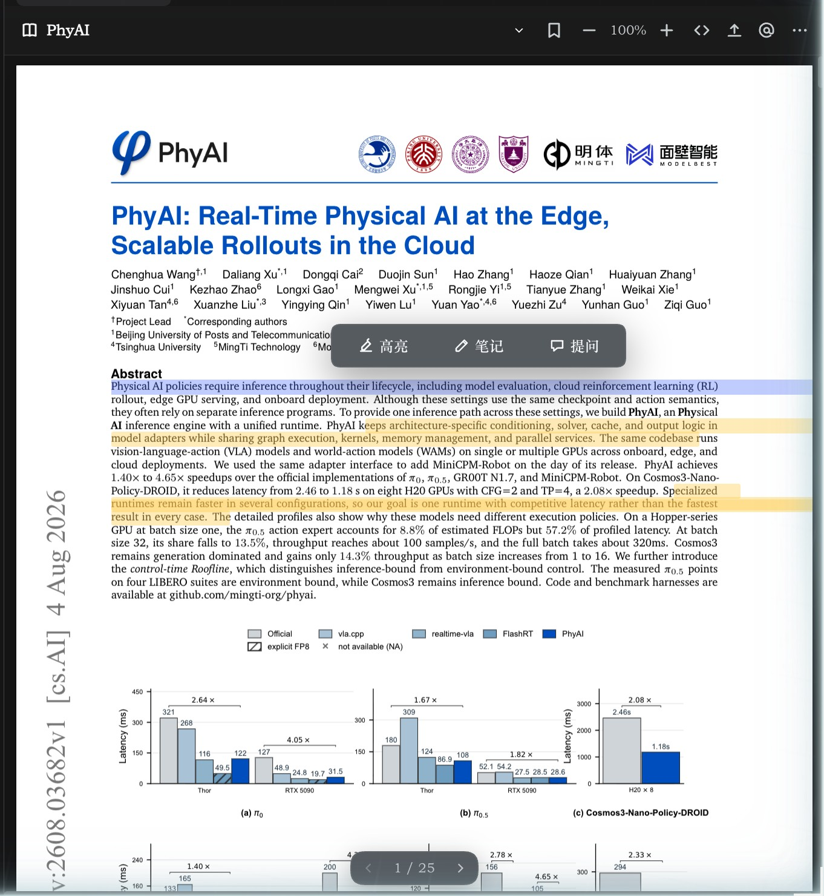
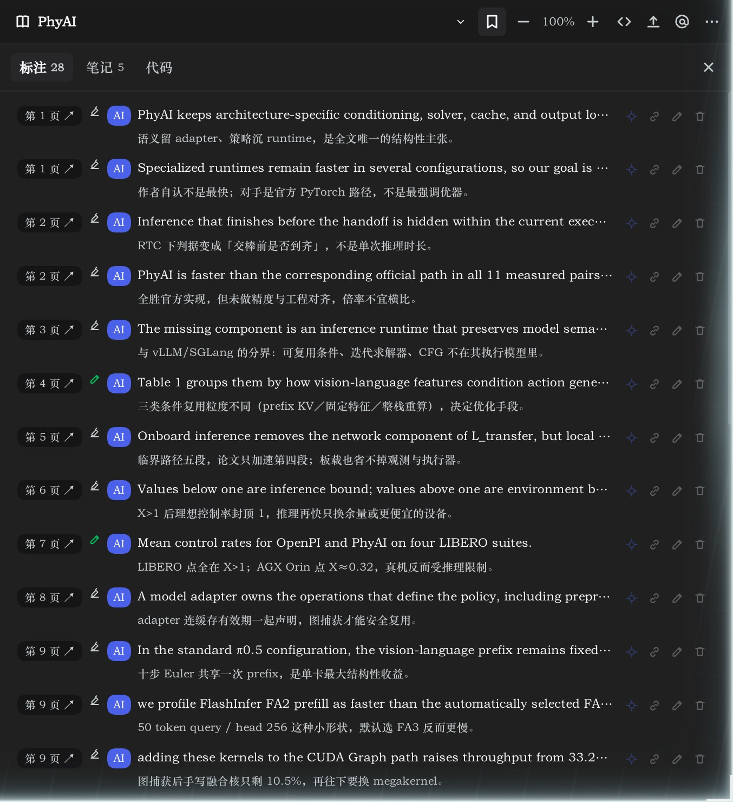
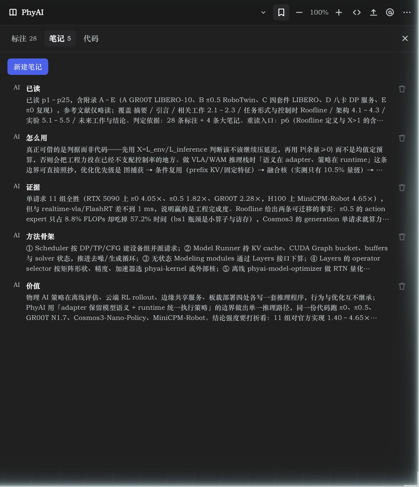
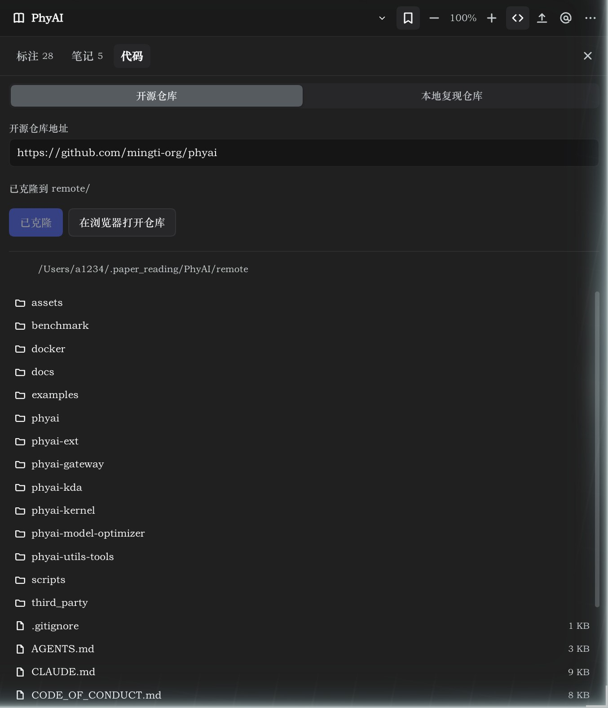

# dsh-vibe-reading



右侧边栏里的论文工作台。PDF 原样打开，读到的留下，AI 接着用。

## 人与 AI 共读，标注和笔记是同一份

你划的高亮、写下的判断，AI 读得到；AI 读完整篇留下的标注与笔记，你打开就在页边。两边写进同一份 `notes.md`，用「AI / 你」区分作者——不用另开文档交接，也不用心疼对话滚没了。

## 论文与代码放在一起

看到模块想看实现：远程仓库克隆进 `remote/`，自己的复现放 `local/`，两套目录都能浏览。点一个文件，就让 agent 对照论文读它——从 claim 一路走到 kernel，不用切窗口复制粘贴。

## 长在 DSH 生态里

一个侧栏 tab、一个模型工具 `vibe_reading`、一个 skill `dsh-vibe-reading`。`@` 把 `/dsh-vibe-reading` 手势和论文目录写进输入框，正文由 DSH 的 skill 机制按需加载；MinerU 解析在插件自己的 JS 里跑，不依赖外部脚本；设置页复用 DSH 自带表单，跟内置设置同一套手感。

还有：选中即高亮 / 笔记 / 提问（提示词语言跟随界面）、标注点页码原地跳转、`vibe://<docId>@p<page>` 深链、论文库网格与阅读位置记忆、损坏的 PDF 只提示不改写。

## 界面



| 选中即用 | 标注与笔记 |
| --- | --- |
|  |  |
| **论文级笔记** | **代码：开源 / 本地两套目录** |
|  |  |

## 安装

```bash
# 从 GitHub 安装
dsh plugin --profile web add github:jypjypjypjyp/dsh-vibe-reading

# 或在本地插件目录里 link 进去（开发调试）
dsh plugin --profile web add link:./projects/dsh-vibe-reading
```

装完重启一次 `dsh web`（Host 路由在启动时注册），右侧边栏的 `+` 里就有「Vibe Reading」。

阅读器的入口挂在 better-sidebar 上，所以插件把 `dsh-better-sidebar` 声明成依赖：pnpm 装插件时会一并装下来。若目标 profile 里它还没被激活（插件列表里没有 `dsh-better-sidebar` 这一层），插件页会出现一条「缺少依赖：右侧边栏」的横幅，点「安装依赖」会自动跑 `dsh plugin --profile <名字> add dsh-better-sidebar` 并把它写进 `dsh.profile.bundles`，重启后生效；没有侧栏时插件本身照常加载，只是没有入口。

## 使用

1. 打开右侧边栏，点 `+`，选「Vibe Reading」。
2. 点工具栏的上传按钮（或把 PDF 拖进面板）导入论文。导入后静默用 markitdown 转一份 Markdown；「更多 → 解析正文（MinerU）」会中断它、改用 MinerU（要 Token），底部进度条实时走。
3. 选中正文文字，使用浮出菜单；工具栏的 `</>` 打开「代码」页，`@` 把 `/dsh-vibe-reading` 与论文目录写进输入框，`⋯` 里有「解析正文（MinerU）」与「设置」。
4. 面板三栏：**标注**（挂在某页某段原文上的高亮与批注，第二行显示它的笔记）、**笔记**（论文级的分块结论，可多条，随时增删改）、**代码**（再分「开源仓库 / 本地复现仓库」两个页签，各有目录浏览）。

设置（工作目录、MinerU Token、模型、语言）统一放在左侧「插件」→ `dsh-vibe-reading` 详情页，用 DSH 自带的设置表单渲染（`@deepseek-ai/dsh-client-ui-primitives` 的 `SettingsForm` / `SettingsValueField` / `SettingsSecretField`，与「网页搜索」等内置设置页同一套控件）；阅读器里的「设置」直接跳到那一页。

## 结构

| 文件 | 作用 |
| --- | --- |
| `index.js` | Host：`/vibe-reading` 路由（库、上传、元数据/标注、设置、双引擎解析、论文文件夹、目录浏览、PDF 字节、pdf.js 静态资源）与 `vibe_reading` 工具 |
| `client.js` | Client：向 `ctx.betterSidebar` 注册 `vibe-reading` tab（阅读器、标注/代码面板），并向 `plugins.detail.section` 注册插件页里的「阅读器设置」 |
| `public/` | vendored pdf.js 3.11（`pdf.min.js`、worker、cmaps、standard_fonts），Apache-2.0，许可证见 `public/LICENSE-pdfjs.txt` |

存储：`~/.dsh/vibe-reading/` 是内部库（`<uuid>.pdf` 原件、`<uuid>.json` 元数据、`settings.json` 设置）；对外的论文文件夹在 `~/.paper_reading/<论文名>/`，按 `pdf/` 原件、`markdown/` 解析结果（可能带 `images/`）、`remote/` 开源实现、`local/` 本地复现分开放，标注与笔记统一写 `notes.md`、元信息写 `meta.md`。

## 批注工具

`vibe_reading` 面向模型：`action=list` 不带 `docId` 列出论文库，带 `docId` 读该论文的全部标注与笔记；`action=create` 写一条标注（`page` + `text` + `note`，作者记为 AI）；`update` / `delete` 按 id 改删；`action=note` / `update_note` / `delete_note` 管论文级笔记；`action=code` 读或写这篇论文的代码仓库（`repo` / `path`），阅读器「AI 查找仓库」按钮就是让 agent 走这条路自动回填。

## 跨会话记忆 skill

插件在 `apply()` 里用 `ctx.inject(['skills'])` + `ctx.skills.register()` 注册了一个运行时 skill `dsh-vibe-reading`：工具清单（`vibe_reading` 的每个 action）、论文目录里有什么、什么时候该写、每条写多短、什么不该写。

它出现在 agent 的 skill 目录里，模型可以自行调用；点阅读器的 `@` 时，输入框里写的是 `/dsh-vibe-reading` 这个手势加论文目录信息，由 DSH 的 skill 机制按需加载正文（`dsh-tool-skill` 用 `/(^|\s)\/([a-z0-9-]+)(?=\s|$)/` 扫描用户消息），而不是把正文粘进对话。

规则很短：标注挂原文、笔记记判断，每条一句话不超过 40 字，只写结论与依据，不写推测与过程。

## 损坏的 PDF

文件按原样保存，阅读器不会尝试改写。若 PDF 结构损坏（例如缺少 `xref` / `%%EOF`，常见于下载中断），打开时会给出说明，并提供「下载原件」和「重试」，方便用其它工具修复后再导入。
